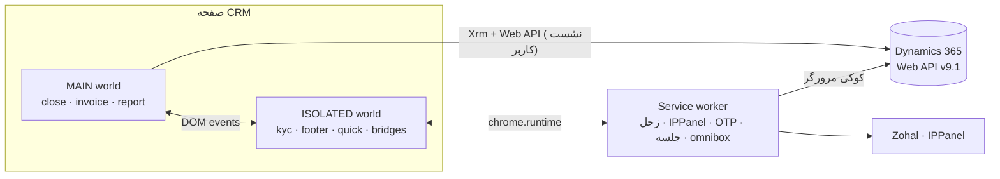

<div align="center">

# DY CRM Toolkit

**جعبه‌ابزار فروش برای Dynamics 365 on‑prem 9.1**
فاکتور فارسی · شماره‌گذاری فرصت · احراز هویت زحل · بستن سریع فرصت · جلسه‌ی سریع · داشبورد فروش


</div>

<div dir="rtl">

## ✨ امکانات

| | امکان | توضیح |
|:-:|---|---|
| 📊 | **داشبورد فروش** | KPI، روند، رتبه‌بندی، سهم از فروش، مقایسه با دوره‌ی قبل، تقویم شمسی؛ با `novinvn://report` باز می‌شود |
| 🧾 | **فاکتور فارسی** | چاپ فرم فرصت = «صورت‌حساب فروش کالا و خدمات» (A4 افقی، شماره‌ی سریال = شماره‌ی فرصت) |
| 🔢 | **شماره‌ی ماهانه‌ی فرصت** | قالب `YMMNNNN` با تقویم شمسی؛ هر ماه از نو شروع می‌شود |
| 🪪 | **احراز هویت (KYC)** | استعلام کد ملی / شناسه‌ی ملی از زحل، تأیید با OTP پیامکی IPPanel و پیامک خوش‌آمدگویی |
| 🏁 | **بستن فرصت** | «بستن به عنوان برنده» و «تغییر مرحله» (پرش مستقیم به هر مرحله‌ی BPF) |
| 📦 | **ابزار محصول** | جستجوی فوری محصول با کلیدهای جهت‌نما و افزودن با قیمت پر شده |
| ⏱️ | **پنل جلسه** | چند جلسه‌ی هم‌زمان، توقف/ادامه/لغو و بازیابی؛ پایان جلسه محصول `INT-009` را به‌اندازه‌ی دقایق فعال اضافه می‌کند |
| ⚡ | **جلسه‌ی سریع** | از هر تب مرورگر: دو بار Shift = شروع، دو بار Ctrl = پایان |
| 🖨️ | **پاورقی چاپی** | پاورقی سه‌ناحیه‌ای با شماره‌ی صفحه، تاریخ شمسی، عنوان، آدرس و متن دلخواه |

---

## 📊 داشبورد فروش و `novinvn://report`

داشبورد روی صفحه‌ی CRM باز می‌شود و با نشست وارد‌شده‌ی شما از Web API می‌خواند (بدون توکن).

| روش باز کردن | چطور |
|---|---|
| آدرس `novinvn://report` | بعد از نصب هندلر ویندوز، هر جا تایپ یا کلیک شود |
| نوار آدرس Chrome | `nv` ← <kbd>Tab</kbd> ← `report` ← <kbd>Enter</kbd> |
| دکمه‌ی شناور | «گزارش فروش» در لیست فرصت‌ها |
| لینک داخل CRM | `<a href="novinvn://report">` |
| آدرس مستقیم | `https://<crm>/#novinvn=report` |

Chrome اجازه نمی‌دهد افزونه اسکیم `novinvn://` را ثبت کند؛ برای همین فایل `tools/protocol/install-novinvn.bat` اسکیم را در ویندوز ثبت می‌کند و آدرس را به لینک CRM ترجمه می‌کند (بدون نیاز به Admin).
جزئیات: [`docs/NOVINVN.md`](docs/NOVINVN.md)

---

## 🚀 نصب

```bash
git clone https://github.com/noviincn-create/Dy-crm-toolkit.git
cd Dy-crm-toolkit
npm install
npm run build
```

1. در Chrome به `chrome://extensions` بروید و **Developer mode** را روشن کنید.
2. **Load unpacked** را بزنید و پوشه‌ی `dist/` را انتخاب کنید.
3. صفحه‌ی تنظیمات افزونه را باز کنید و توکن زحل و کلید IPPanel را وارد کنید.
4. (اختیاری) برای `novinvn://report` فایل `tools/protocol/install-novinvn.bat` را اجرا و بعد Chrome را کامل ببندید و دوباره باز کنید. اگر در نوار آدرس جستجوی Google باز شد، [عیب‌یابی](docs/NOVINVN.md#عیب‌یابی-در-نوار-آدرس-chrome-جستجوی-google-باز-می‌شود) را ببینید.

> [!NOTE]
> شناسه‌ی افزونه‌ی unpacked به مسیر پوشه بستگی دارد؛ با تغییر پوشه، تنظیمات و توکن‌ها باید دوباره وارد شوند.

---

## ⌨️ میان‌بُرها

| کار | میان‌بر |
|---|---|
| شروع جلسه‌ی سریع | دو بار <kbd>Shift</kbd> |
| پایان جلسه‌ی سریع | دو بار <kbd>Ctrl</kbd> |
| بستن پنجره‌ها | <kbd>Esc</kbd> |
| داشبورد از نوار آدرس | `nv` ← <kbd>Tab</kbd> ← `report` |

کلیدها و فاصله‌ی زمانی دابل‌تپ از صفحه‌ی تنظیمات قابل تغییر است.

---

## 🧩 معماری



- **MAIN world**: به `Xrm` دسترسی دارد و برای کارهای داخل فرم و صفحه استفاده می‌شود.
- **ISOLATED world و service worker**: تماس با سرویس‌های بیرونی اینجاست، پس کلیدهای API هرگز به صفحه‌ی Dynamics نمی‌رسند.
- هر ورودی به‌صورت IIFE مستقل باندل می‌شود (content scriptها نمی‌توانند ES module باشند).

<details>
<summary><b>ساختار پوشه‌ها</b></summary>

```
src/
  shared/      config، پیام‌های تایپ‌شده، jalali (تقویم + زمان تهران)، odata (کلاینت Web API)، text، xrm
  background/  service worker: زحل، IPPanel، OTP، جلسه‌ی سریع، omnibox
  kyc/         پنل KYC
  invoice/     داده، رندر و استایل فاکتور؛ فونت‌های یکان و تیتر (tools/embed-fonts.mjs)
  close/       ابزار فرصت: مراحل، بستن، تغییر مرحله، شماره‌ی فرصت، ایجاد، جلسه، محصولات
  session-manager/  توقف/ادامه/لغو و بازیابی جلسه‌ها (docs/SESSION-MANAGER.md)
  quick/       جلسه‌ی سریع روی همه‌ی سایت‌ها
  footer/      پاورقی چاپی
  report/      داشبورد فروش: data، dates، view، export، bridge
  options/     صفحه‌ی تنظیمات
  types/       تایپ‌های ambient برای Xrm و window
public/        manifest.json، options.html، فونت فاکتور
tests/         تست‌های jsdom (و Playwright برای فاکتور)
tools/         مهاجرت شماره‌ها، embed فونت، protocol/ (هندلر ویندوز)
docs/          مستندات ماژول‌ها
```

</details>

---

## 🛠️ توسعه

```bash
npm run typecheck      # tsc strict روی src و تنظیمات سبک‌تر روی tests
npm run build          # خروجی در dist/
npm run watch          # بیلد خودکار
npm test               # build + همه‌ی تست‌های jsdom
npm run test:report    # فقط داشبورد و مسیریابی novinvn
npm run test:invoice   # نیاز به: npx playwright install chromium
npm run build:tools    # اسکریپت مهاجرت شماره‌ها برای paste در کنسول
npm run zip            # dist/ به‌صورت zip
```

---

## 📚 مستندات

- [`docs/NOVINVN.md`](docs/NOVINVN.md): داشبورد فروش و آدرس `novinvn://`
- [`docs/SESSION-MANAGER.md`](docs/SESSION-MANAGER.md): مدیریت جلسه (توقف، ادامه، بازیابی)
- [`tests/README.md`](tests/README.md): راهنمای تست‌ها

---

<div align="center">

ساخته‌شده برای **کافی‌نت نوین** · Persian RTL · Dynamics 365 CE 9.1

</div>

</div>
